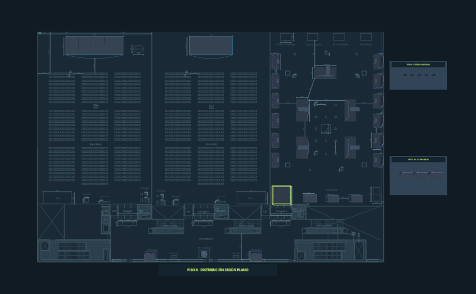

# Credicorp · LED Studio

Proyecto 3D editable de iluminación para **Credicorp IA, Data & Ciberseguridad Summit 2026**, preparado por LIGHTMAN.

**[Abrir el editor 3D](https://lightmanshows.github.io/credicorp-led-studio-2026/)**

Incluye 34 piezas y 215 recorridos LED. Permite mover, girar y redimensionar las piezas; editar color, intensidad y posición de cada recorrido; guardar y abrir ajustes; y exportar GLB, CSV o una captura.

## Descargas

- [Proyecto completo ZIP](downloads/credicorp-proyecto-completo.zip)
- [Modelo completo GLB](entregables/credicorp-completo.glb)
- [Proyecto editable JSON](entregables/credicorp-proyecto.json)
- [Listado de recorridos LED CSV](entregables/credicorp-listado-led.csv)
- [Guía de uso y referencias](LEEME.md)

## Alcance

1 túnel, 12 stands Innovation con sus credenzas, 5 stands Presenting con sus credenzas, 8 módulos de alimentos, 1 tarima MR Analityc, 5 tótems y 2 escenarios.

Actualizado el 21 OCT: distribución de piso 8 trazada sobre el plano del 19 OCT y confirmaciones de Sonny. Credicorp es el quinto Presenting; Al.1–3 pertenecen al piso 7. Cinco tótems y Al.1–3 se muestran aparte, por ubicar. Las posiciones son referencias aproximadas. Las medidas sin confirmar y las diferencias entre planos y presentación se indican dentro del editor y en la guía. Las longitudes son geométricas y no incluyen alimentación, cableado ni merma.

## Uso local

En Windows, descomprime el ZIP y ejecuta `iniciar.cmd`. El proyecto utiliza JavaScript y Three.js incluidos en `dist/vendor`; no requiere descargar dependencias.

Los cambios se guardan en el navegador utilizado. Usa **Guardar proyecto** para descargar un JSON y compartir o conservar una versión.

Three.js conserva su licencia MIT en `dist/vendor/THREE-LICENSE.txt`.
